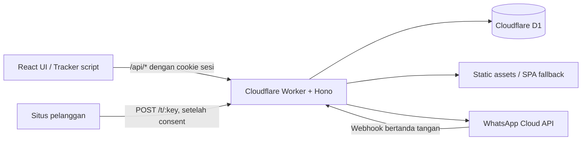

# Arenka Ads Tracker — Panduan Handoff untuk Agent AI

**Tanggal dokumentasi:** 25 November 2026  
**Bahasa produk dan dokumentasi:** Indonesia  
**Tujuan:** membantu agent berikutnya memahami kode, alur UI/UX, backend, batas fitur, cara menjalankan, dan aturan perubahan tanpa menebak-nebak.

> Dokumen ini menjelaskan kode yang ada; ini bukan salinan kedua seluruh source. Source kanonis tetap berada di file proyek yang ditautkan di bawah. Jangan menyalin kode ke dokumen ini karena salinan akan cepat berbeda dari implementasi.

## Mulai di sini

Sebelum mengubah apa pun, baca dalam urutan berikut:

1. [`AGENTS.md`](AGENTS.md) — instruksi repo dan keputusan arsitektur.
2. [`design-system/arenka-ads-tracker/MASTER.md`](design-system/arenka-ads-tracker/MASTER.md) — acuan desain UI.
3. [`README.md`](README.md) — modul, perintah, deployment, dan batas provider.
4. [`AUDIT_TOMBOL_2026-11-25.md`](AUDIT_TOMBOL_2026-11-25.md) — hasil audit tombol pada sesi produksi.
5. Bagian kode terkait dalam tabel di bawah; jangan membaca atau mengubah seluruh repo jika satu modul sudah cukup.

Jika dokumentasi dan kode tidak cocok, anggap kode aktif sebagai keadaan aktual, catat selisihnya, lalu perbarui dokumentasi bersama perubahan implementasi.

## Ringkasan produk

Arenka Ads Tracker adalah dashboard atribusi lead: event dari halaman web dikirim ke Cloudflare Worker, disimpan di D1 bersama UTM dan informasi lead, lalu disajikan sebagai ringkasan, laporan, event log, dan alur follow-up. Beberapa modul menggunakan WhatsApp Cloud API dan API webhook.

Aplikasi mengambil inspirasi alur kerja dari Dalekta, tetapi menggunakan nama, kode, dan aset Arenka sendiri. Jangan menyalin logo/aset Dalekta atau mengklaim integrasi aktif jika backend provider belum benar-benar tersedia.

## Stack dan struktur kode

| Bagian | Teknologi / file kanonis | Fungsi |
|---|---|---|
| UI | React 19, TypeScript, Vite | Aplikasi satu halaman, state UI dan navigasi internal. |
| Styling | Tailwind CSS v4, `src/styles.css`, komponen lokal `src/components/ui` | Token visual dan komponen `Button`, `Card`, `Input`, `Select`, `Badge`. |
| Entry browser | [`src/main.tsx`](src/main.tsx) | Mount React, memuat font DM Sans dan IBM Plex Mono serta CSS global. |
| Aplikasi utama | [`src/App.tsx`](src/App.tsx) | Auth UI, sidebar, routing internal, halaman dashboard, leads, tracking, WhatsApp, dan settings. |
| API | [`worker/index.ts`](worker/index.ts) | Hono Worker: auth, API, tracker ingestion, webhook, WhatsApp, dan asset fallback. |
| Database | [`migrations/`](migrations/) | D1 SQLite. Migration bernomor dan diterapkan berurutan. |
| Runtime / deploy | [`wrangler.jsonc`](wrangler.jsonc), [`vite.config.ts`](vite.config.ts) | Worker, D1, rate limit, asset binding, Email Sending, route domain. |
| Audit UI | [`AUDIT_TOMBOL_2026-11-25.md`](AUDIT_TOMBOL_2026-11-25.md) | Temuan tombol yang diamati pada produksi dan cakupan audit. |

Vite menggabungkan React, Tailwind v4, dan Cloudflare Vite plugin. Build memakai `tsc --noEmit` lalu `vite build`; Worker utama adalah `worker/index.ts` dan file statis dibaca dari `dist`.

## Alur request dan data



1. React memuat `/api/me`. Sesi valid mengembalikan workspace aktif; jika tidak ada sesi, UI menampilkan login.
2. User actions meminta endpoint `/api/*`. Middleware memverifikasi origin dan cookie session, lalu memasang `userId`, `workspaceId`, dan workspace ke context.
3. Semua query data workspace wajib dibatasi `workspace_id`. Pengecualian terbatas untuk autentikasi atau endpoint publik yang memakai public key/token khusus.
4. Tracker publik memakai `POST /t/:key`; kunci publik hanya mengidentifikasi workspace, bukan kredensial API privat.
5. Worker menyimpan event/lead di D1; UI membaca melalui API yang sesuai.

## UI/UX: navigasi, halaman, dan perilaku

Login mode di `AuthScreen`: masuk, buat akun, lupa kata sandi, dan setel kata sandi melalui reset token. Dashboard memakai sidebar grup Workspace, WhatsApp, Tracking, dan Pengaturan; sidebar dapat diciutkan di viewport kecil. Toast/status, dialog, empty state, filter, loading, dan disabled state ada di `src/App.tsx`.

| Rute | Komponen | Tujuan / status |
|---|---|---|
| `/` | `DashboardPage` | Ringkasan lead, biaya, revenue, ROAS, sumber lead, funnel, dan langkah pemasangan tracker. |
| `/inbox` | `InboxPage` | Percakapan WhatsApp, baca/kirim pesan, ubah status, template dan balasan cepat. Perlu koneksi Meta. |
| `/leads` | `LeadsPage` | Cari/filter, daftar atau Kanban, CSV import/export, tambah/edit lead, follow-up. |
| `/reports/campaign` | `ReportPage` | Rentang tanggal, mode konversi, biaya manual, agregasi performa, share/CSV. |
| `/leads/locations` | `LeadLocationsPage` | Metrik event menurut perkiraan lokasi Cloudflare; CSV aktif bila data ada. |
| `/whatsapp/sessions` | `WhatsAppSettingsPage` | Simpan Phone Number ID, WABA, access token, App Secret, verify token, versi Graph API. Secret dienkripsi. |
| `/whatsapp/rotator` | `WhatsAppRotatorsPage` | Buat link dan nomor tujuan round-robin, aktif/nonaktif dan hapus. |
| `/whatsapp/rules` | `WhatsAppRulesPage` | Aturan kata kunci dan balasan otomatis untuk pesan baru. |
| `/whatsapp/quick-replies` | `QuickRepliesPage` | CRUD balasan cepat; tombol sisip hanya mengisi composer sampai user mengirim. |
| `/whatsapp/templates` | `WhatsAppTemplatesPage` | Baca/sinkronkan template dari WABA. Pengiriman mensyaratkan status APPROVED. |
| `/whatsapp/broadcast` | `WhatsAppBroadcastPage` | Bukti persetujuan pemasaran, draft kampanye, batch penerima, status delivery/read/fail. Perlu template MARKETING APPROVED dan koneksi Meta. |
| `/whatsapp/form-katalog` | `PlannedModule` | Placeholder; belum terhubung backend. |
| `/whatsapp/biaya` | `PlannedModule` | Placeholder; belum terhubung backend. |
| `/tracking/ads` | `IntegrationsPage`, `UtmPage` | Platform, event mapping, tracker code, parameter UTM. OAuth iklan belum aktif. |
| `/tracking/domains` | `CustomDomainsPage` | Allowlist hostname untuk origin event saja; bukan provisioning DNS/SSL. |
| `/tracking/landing-page` | `LandingPagesPage` | CRUD/publish halaman kampanye publik dengan CTA WhatsApp. |
| `/tracking/sumber-lead` | `LeadSourcesPage` | Koneksi dan sinkronisasi order Mayar, cocokkan order ke lead. Memerlukan API key Mayar. |
| `/tracking/audiens` | `AudiencesPage` | Segmen berdasarkan tahap lead; ekspor email/telepon yang dinormalisasi sebagai SHA-256. Tidak mengirim audience otomatis ke platform. |
| `/tracking/ad-research` | `AdResearchPage` | Simpan kompetitor dan swipe-file; tautan Meta Ad Library, bukan OAuth ke akun iklan. |
| `/event-logs` | `EventsPage` | Maksimal 100 event terakhir. |
| `/settings/workspace` | `WorkspaceSettingsPage` | Ubah nama workspace dan salin public tracker key. |
| `/settings/team` | `PlannedModule` | Placeholder; role/member management belum dibuat. |
| `/settings/billing` | `PlannedModule` | Placeholder; billing aplikasi belum dibuat. |
| `/settings/affiliate` | `PlannedModule` | Placeholder; afiliasi belum dibuat. |
| `/settings/api-webhook` | `WebhooksPage` | CRUD webhook inbound/outbound, event delivery, retry, uji endpoint. Uji webhook mengirim HTTP ke URL eksternal. |

Komponen UI lokal berada di `src/components/ui`. Untuk menambah control, gunakan semantik `<button>`/form yang benar, label aksesibel, disabled/loading state, toast sukses/gagal, dan empty/error state. Semua control aktif harus memiliki handler atau submit form yang jelas. Acuan desain visual resmi repo adalah `MASTER.md`; jangan mengganti warna/font/spacing berdasarkan dugaan.

### Hal yang ditemukan dari audit UI

- Audit produksi 25 November 2026 membuka seluruh 25 rute menu tanpa halaman error.
- Ikon **Notifikasi** saat itu tidak memiliki handler; klik tidak memberi respons.
- 5 rute placeholder disebut di tabel. Jangan menggambarkannya sebagai fitur selesai.
- Dialog Integrasi `Hubungkan` hanya menyimpan metadata nama/ID akun; tidak melakukan OAuth.
- Saat akun tidak memiliki data, tombol ekspor laporan/lokasi nonaktif. Ini adalah empty state, bukan bukti ekspor sudah berfungsi dengan data.
- Audit rinci dan batas validasi ada di `AUDIT_TOMBOL_2026-11-25.md`.

## Backend, autentikasi, dan keamanan

### Middleware dan session

- Semua `/api/*` memeriksa `Origin` terhadap origin Worker/`APP_ORIGIN`.
- Endpoint auth dikecualikan dari pemeriksaan cookie. Endpoint API lain memerlukan `arenka_session` yang ditandatangani HMAC-SHA256 dengan `SESSION_SECRET`.
- Cookie sesi `httpOnly`, `Secure` pada HTTPS, `SameSite=Lax`, path `/`, masa berlaku 14 hari.
- Validasi sesi membaca `session_version`; reset password menambah version sehingga sesi lama ditolak.
- Password di-hash dengan PBKDF2 SHA-256 melalui `node:crypto` (100.000 iterasi, salt acak). Jangan menyimpan atau mengembalikan password teks biasa.
- Auth rate limit bernama `AUTH_RATE`: 30 request per 60 detik; tracker `TRACKER_RATE`: 600 request per 60 detik. Definisi berada di `wrangler.jsonc`.
- Password reset: token acak, yang disimpan hanya hash SHA-256, kedaluwarsa 30 menit, sekali pakai. Pemulihan email perlu `RESET_EMAIL_FROM` dan Cloudflare Email Sending yang sudah onboard atau `RESEND_API_KEY` sebagai fallback. Jangan membuat endpoint login bypass atau password default.

### Ringkasan endpoint

Semua path berikut diawali `/api` kecuali dinyatakan lain. Implementasi validasi dan bentuk payload aktual berada pada handler di `worker/index.ts`; cek handler sebelum mengubah kontrak.

| Grup | Endpoint utama |
|---|---|
| Auth | `POST /auth/register`, `/auth/login`, `/auth/forgot-password`, `/auth/reset-password`, `/auth/logout`; `GET /me`. |
| Workspace | `PUT /workspace`. |
| Dashboard & laporan | `GET /summary`, `/report`, `/events`, `/lead-locations`; `POST /costs`. |
| Leads | `GET /leads`; `POST /leads`, `/leads/import`; `PATCH /leads/:id`. Query, patch, dan import wajib workspace-scoped. |
| Ad platform & UTM | `GET /integrations`, `PUT /integrations/:platform`; `GET /mappings`, `PUT /mappings`; `GET /tracking/status`. Ini metadata dan mapping; belum OAuth provider. |
| Landing pages | `GET/POST /tracking/landing-pages`; `PUT/DELETE /tracking/landing-pages/:id`; publik `GET /lp/:slug`. |
| Domain | `GET/POST /tracking/domains`; `DELETE /tracking/domains/:id`. Hanya allowlist, belum Cloudflare for SaaS. |
| Audience | `GET/POST /audiences`; `POST /audiences/:id/export`; `DELETE /audiences/:id`. Export hanya hash kontak; bukan sync otomatis. |
| Ad research | `GET/POST /ad-research/competitors`; `DELETE /ad-research/competitors/:id`; `GET/POST /ad-research/swipe`; `PATCH/DELETE /ad-research/swipe/:id`. |
| Mayar source | `GET /sources`; `PUT/DELETE /sources/mayar`; `POST /sources/mayar/sync`. Simpan secret terenkripsi, jangan return ke UI. |
| WhatsApp connection | `GET/PUT /whatsapp/connection`; `GET /whatsapp/templates`; pesan template `POST /inbox/conversations/:id/templates`. |
| Inbox | `GET /inbox/conversations`, `GET /inbox/conversations/:id/messages`; `PATCH /inbox/conversations/:id`; `POST /inbox/conversations/:id/messages`. Pengiriman membuat side effect eksternal ke Meta. |
| Consent & broadcast | `GET /whatsapp/consents`; `POST /whatsapp/consents/:leadId`; `GET/POST /whatsapp/broadcasts`; `POST /whatsapp/broadcasts/:id/start`, `/:id/batch`. Tiap batch mengecek ulang opt-in dan template Meta approved. |
| Rotator | `GET/POST /whatsapp/rotators`; `DELETE /whatsapp/rotators/:id`; public redirect `GET /r/:slug`. |
| Quick replies & rules | `GET/POST /whatsapp/quick-replies`; `PUT/DELETE /whatsapp/quick-replies/:id`; `GET/POST /whatsapp/rules`; `PUT/DELETE /whatsapp/rules/:id`. |
| Webhook aplikasi | `GET /webhooks`; POST/PATCH/DELETE outbound/inbound endpoint; `POST /webhooks/outbound/:id/test`, `/webhooks/outbound/deliveries/:id/retry`; penerima publik `POST /webhooks/inbound/:id`. Uji/retry dapat mengirim request ke URL yang disimpan user. |
| Tracker & Meta webhook | `GET /tracker.js`, `POST /t/:key`; WhatsApp callback `GET/POST /webhooks/whatsapp`. Verifikasi signature Meta dilakukan di handler. |
| SPA assets | `ALL *` menyerahkan request non-API yang bukan tracker/webhook ke binding `ASSETS` dengan fallback SPA. |

> Gunakan `rg -n 'app\\.(get|post|put|patch|delete|all)' worker/index.ts` untuk daftar aktual. Tabel ini ringkasan untuk onboarding, bukan kontrak API pengganti source.

### Batas workspace

Mayoritas tabel memiliki `workspace_id`. Query baru dan mutasi record harus mencocokkan `id` **dan** `workspace_id` dari sesi server. Jangan percaya `workspace_id` yang dikirim browser. Public tracker key harus resolve workspace di server, lalu event dikaitkan ke workspace yang resolve. Tabel global yang sempit (mis. users atau token reset) perlu aturan ownership sendiri.

## Database dan migration

Urutan migration saat ini `0001`–`0018`:

| Migration | Perubahan utama |
|---|---|
| `0001_initial.sql` | `users`, `workspaces`, `leads`, `events`, `event_mappings`, `integrations`, `ad_costs` dan index awal. |
| `0002_lead_visitor_id.sql` | Identitas visitor lead untuk deduplikasi/atribusi. |
| `0003_password_reset.sql` | Password reset token/limits dan session version. |
| `0004_event_locations.sql` | Negara/region/city di event; tidak menyimpan IP mentah. |
| `0005_lead_followup.sql` | Kolom jadwal/catatan follow-up lead. |
| `0006_whatsapp_inbox.sql` | Koneksi, percakapan, pesan WhatsApp. |
| `0007_whatsapp_lead_attribution.sql` | Hubungkan percakapan ke lead. |
| `0008_ad_research.sql` | Kompetitor dan swipe ads. |
| `0009_custom_audiences.sql` | Segmen audience tersimpan. |
| `0010_lead_sources.sql` | Koneksi store dan order source. |
| `0011_webhooks.sql` | Webhook endpoint, delivery, request deduplication, rate limits. |
| `0012_custom_domains.sql` | Allowlist hostname workspace. |
| `0013_wa_quick_replies.sql` | Balasan cepat. |
| `0014_whatsapp_rotators.sql` | Rotator, destination, counter klik. |
| `0015_tracking_landing_pages.sql` | Landing pages dan status published. |
| `0016_whatsapp_rules.sql` | Aturan keyword reply. |
| `0017_whatsapp_broadcasts.sql` | Persetujuan pemasaran, broadcast, recipients. |
| `0018_whatsapp_broadcast_delivery.sql` | Status sent/delivered/read/failed dan timestamp. |

Jangan edit migration yang sudah diterapkan. Tambahkan file migration bernomor baru, periksa foreign key/index/workspace scope, lalu terapkan ke lokal/remote sesuai lingkungan. Migration remote adalah perubahan data/schema produksi.

### Tabel inti per domain

`users`, `workspaces`; `leads`, `events`, `ad_costs`; `integrations`, `event_mappings`; `password_reset_tokens`, `password_reset_limits`; `wa_connections`, `wa_conversations`, `wa_messages`; `ad_research_competitors`, `ad_research_swipe_ads`; `custom_audiences`; `store_connections`, `source_orders`; inbound/outbound webhook tables; `custom_domains`; `wa_quick_replies`; `wa_rotators`, destinations, counters; `tracking_landing_pages`; `wa_rules`; marketing consent/broadcast/recipient tables.

## Tracking script dan consent

Script dipasang dari origin Worker:

```html
<script async src="https://trackers.arenka.biz.id/tracker.js?k=WORKSPACE_KEY"></script>
```

Tracker membuka consent UI. Sebelum `granted`, event dikumpulkan di antrean memori dan tidak dikirim; `denied` menghapus antrean. Setelah izin, script menyimpan visitor id lokal, menangkap UTM sesi, `Visit LP`, CTA WhatsApp, dan `[data-track]`. Custom event:

```js
window.arenkaTrack("Isi Form", {
  name: "Nama kontak",
  email: "email@contoh.id",
  phone: "+628123456789"
});
```

Kirim custom event sesudah aksi formulir berhasil, bukan pada klik submit yang gagal. Pemilik situs bertanggung jawab atas pemberitahuan/consent sesuai kebijakan yang berlaku. Payload tracker dibatasi; jangan kirim password, access token, atau data sensitif yang tidak diperlukan.

## Provider eksternal dan status nyata

| Integrasi | Status saat ini |
|---|---|
| Meta/Google/TikTok/GA4/LinkedIn/ChatGPT Ads | Nama dan ID akun + event mapping; OAuth/sinkronisasi spend live belum diimplementasikan. Biaya campaign dapat dimasukkan manual. |
| WhatsApp Cloud API | Implementasi API, webhook, Inbox, template, consent, rules, rotator, broadcast tersedia di kode; produksi perlu kredensial Meta valid, webhook terverifikasi, template approved, dan opt-in penerima. |
| Mayar | Koneksi/sinkronisasi manual melalui API key. Belum berarti order otomatis masuk tanpa menekan sinkronisasi. |
| Cloudflare Email Sending | Binding `EMAIL` dibatasi sender `no-reply@arenka.biz.id` dan destination akun pemilik dalam `wrangler.jsonc`. Domain harus di-onboard; penerima eksternal memerlukan Workers Paid. Resend fallback memerlukan `RESEND_API_KEY`. Status onboarding/pengiriman belum dibuktikan hanya dari adanya binding. |
| Custom domain pelanggan | Allowlist event saja. Cloudflare for SaaS, verifikasi ownership, SSL dan Worker routing belum dibuat. |

## Konfigurasi dan menjalankan lokal

```powershell
npm install
Copy-Item .dev.vars.example .dev.vars
# Ubah SESSION_SECRET lokal menjadi nilai acak kuat.
npm run db:local
npm run dev
```

Perintah utama:

```powershell
npm run build       # TypeScript dan production build
npm run preview     # Preview asset hasil build
npm run db:local    # Migration ke D1 lokal
npm run db:remote   # Migration ke D1 produksi; cek target dahulu
npm run deploy      # Deploy Worker + assets
npx wrangler types  # Perbarui tipe binding sesuai wrangler.jsonc
```

Worker produksi memakai nama `arenka-ads-tracker`, domain `trackers.arenka.biz.id`, database D1 `arenka-tracker`, serta binding `AUTH_RATE`, `TRACKER_RATE`, `EMAIL`, `DB`, dan `ASSETS`. `SESSION_SECRET` hanya sebagai `.dev.vars` lokal atau Wrangler secret. Jangan commit `.dev.vars`, access token, App Secret, API key, password reset token, atau isi secret.

## Aturan deployment dan riwayat Git

- Tujuan repo GitHub: `restupambudi99/arenkaadstracker`.
- Pemilik meminta perubahan dicatat sebagai commit GitHub. Setelah perubahan, cek diff/build, lalu commit file perubahan yang relevan saja.
- Jangan gunakan `git add .` bila ada perubahan lama yang bukan bagian task. Riwayat/status lokal sebelumnya dapat berbeda dari default branch GitHub; cocokkan SHA/blob dan file terlebih dahulu sebelum push atau menimpa file remote.
- Deployment produksi hanya setelah build berhasil dan akun/Worker target benar. Jangan mengubah DNS/route/domain atau menjalankan sinkronisasi/pengiriman eksternal sebagai langkah coba-coba.
- Jangan menyimpan rahasia di `README`, dokumen handoff, source, log, screenshot, atau commit.

## Backlog yang sudah diketahui

1. Beri fungsi yang benar pada tombol Notifikasi atau hilangkan sampai backend notifikasi tersedia.
2. Bangun atau tetap nyatakan placeholder untuk Form & katalog, Biaya WhatsApp, Team, Billing, dan Afiliasi.
3. Implementasikan OAuth/token lifecycle dan sync data iklan sebelum menampilkan platform sebagai terhubung.
4. Jika domain pelanggan akan benar-benar aktif, rancang Cloudflare for SaaS dengan ownership verification, fallback origin, SSL status, provisioning dan cleanup; jangan pakai wildcard Worker route pada zona Arenka.
5. Selesaikan konfigurasi pemulihan email, uji hanya ke recipient yang diizinkan, dan verifikasi status delivery tanpa menampilkan token reset.
6. Audit ulang seluruh rute/tombol setelah fitur/provider berubah. Hindari menguji tombol yang mengirim pesan, mengekspor PII, menghapus data, atau mengubah produksi tanpa izin/konteks yang sesuai.

## Panduan agent berikutnya

Saat menerima task:

1. Jelaskan dalam bahasa Indonesia; gunakan nama/istilah yang konsisten dengan UI.
2. Baca instruksi repo dan file desain sebelum mengubah UI.
3. Temukan fungsi/handler spesifik; periksa endpoint dan migration terkait.
4. Pertahankan workspace scoping, rate limit, validasi input, output escaping, dan secret encryption yang sudah ada.
5. Jangan mengklaim integrasi aktif hanya karena tombol membuka dialog atau data akun tersimpan.
6. Untuk tombol: pastikan handler menghasilkan perubahan yang terlihat, punya error/loading/empty state dan keyboard semantics. Jangan mengirim atau menghapus data produksi saat audit read-only.
7. Tambah migration baru jika schema berubah. Jangan edit migration terapan.
8. Perbarui dokumentasi untuk perubahan kontrak/fitur; catat perubahan di GitHub.

